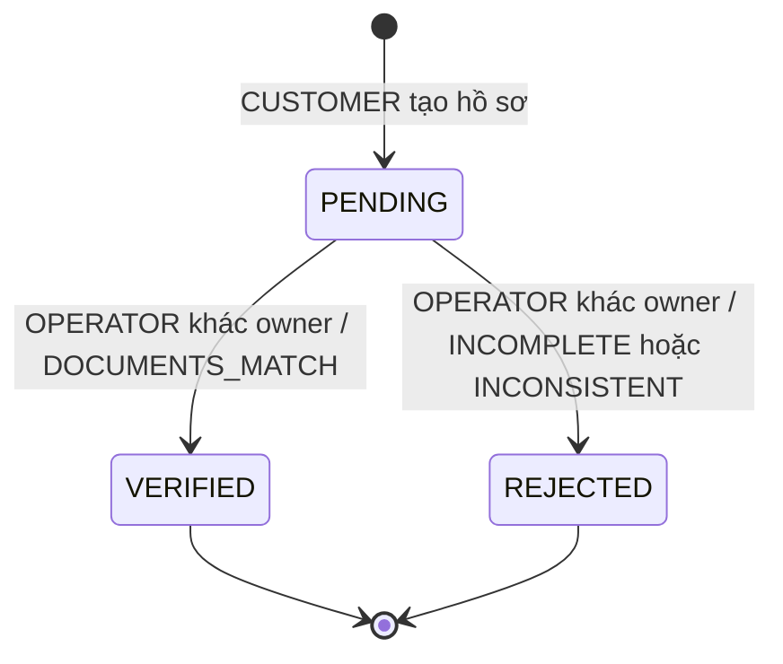
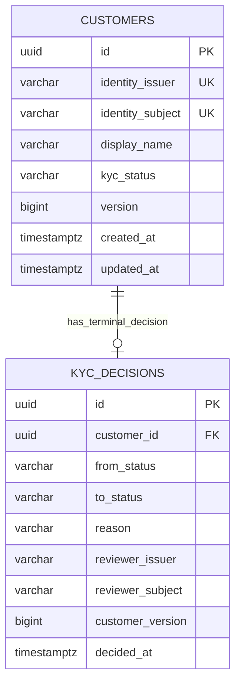

# BL-004 — Customer và KYC mô phỏng

Issue [#7](https://github.com/ThanhDat19/app-bank/issues/7). Phạm vi: hồ sơ cá nhân thử nghiệm,
một identity có một Customer, KYC thủ công giả lập. Không có tài khoản ngân hàng, số dư, giấy tờ/eKYC
thật, tìm kiếm danh sách khách hàng, sửa/xóa hồ sơ hoặc resubmit/re-KYC trong PR này.

## Actors và use cases

- CUSTOMER đã xác thực tạo hồ sơ của chính mình, xem theo `/me` hoặc ID thuộc ownership.
- OPERATOR xem hồ sơ theo ID được cung cấp và quyết định KYC. OPERATOR không tự tạo hồ sơ thay khách hàng.
- User có cả hai role vẫn không được duyệt hồ sơ gắn với identity của mình.
- Login thành công không tự tạo Customer. Tạo Customer không tự chuyển KYC sang VERIFIED.

## Business rules

| ID | Quy tắc | Nơi bảo vệ |
| --- | --- | --- |
| CUS-01 | Owner là cặp issuer/subject của JWT đã xác minh; request không tự khai owner | CurrentActorProvider, service, reject unknown fields |
| CUS-02 | Một identity có đúng tối đa một Customer; không tái sử dụng subject giữa các issuer | DB unique `(identity_issuer, identity_subject)`, insert ON CONFLICT |
| CUS-03 | Tạo mới luôn PENDING/version 0; displayName tổng hợp strip khoảng trắng, 2–80 ký tự, không control/format chars | DTO validation, factory, SQL constraints |
| CUS-04 | Customer chỉ xem chính mình; missing và ngoài ownership đều 404 CUSTOMER_NOT_FOUND | Truy vấn có cả ID + issuer + subject, không tải rồi trả dữ liệu trước authorization |
| KYC-01 | Chỉ OPERATOR quyết định; identity người duyệt khác owner | URL gate, method security, domain rule |
| KYC-02 | Chỉ PENDING → VERIFIED hoặc REJECTED; terminal không quyết định lại | Domain + conditional UPDATE |
| KYC-03 | VERIFIED cần DOCUMENTS_MATCH; REJECTED cần INCOMPLETE/INCONSISTENT | Domain + DB CHECK |
| KYC-04 | expectedVersion phải khớp; mỗi quyết định thắng tăng version đúng một lần | Domain + UPDATE WHERE version và PENDING |
| KYC-05 | Thay trạng thái và insert history phải commit/rollback cùng nhau | Application @Transactional, cùng DataSource |
| CUS-05 | Không trả identity link/reviewer identity ra profile; response không cache | DTO projection, no-store |

DisplayName không phải tên pháp lý đã xác minh. Không nhập PII thật. KYC VERIFIED chỉ là kết quả mô phỏng
để làm điều kiện cho các module kế tiếp; không đáp ứng quy trình định danh của ngân hàng thực tế.



## REST contracts

Mọi route cần bearer token; dùng Swagger OAuth PKCE của BL-003. Request JSON, response JSON,
errors `application/problem+json` theo [conventions](conventions.md). Mọi response qua filter có correlation ID.

| Method/path | Role | Thành công | Lỗi nghiệp vụ |
| --- | --- | --- | --- |
| POST `/api/v1/customers` | CUSTOMER | 201 + Location + profile | 409 CUSTOMER_ALREADY_EXISTS |
| GET `/api/v1/customers/me` | CUSTOMER | 200 profile | 404 CUSTOMER_NOT_FOUND |
| GET `/api/v1/customers/{id}` | CUSTOMER, chỉ owner | 200 profile | 404 CUSTOMER_NOT_FOUND |
| GET `/api/v1/operations/customers/{id}` | OPERATOR | 200 profile | 404 CUSTOMER_NOT_FOUND |
| POST `/api/v1/operations/customers/{id}/kyc-decisions` | OPERATOR, khác owner | 200 profile mới | 404, 409, 422 bên dưới |

POST tạo hồ sơ:

```json
{"displayName":"Customer Demo A"}
```

HTTP 201 với `Location: /api/v1/customers/<id>` và `Cache-Control: no-store`:

```json
{
  "id": "d89b3878-0785-4cfb-ab9b-2a98f43c05fb",
  "displayName": "Customer Demo A",
  "kycStatus": "PENDING",
  "version": 0,
  "createdAt": "2026-10-25T13:00:00.123456Z",
  "updatedAt": "2026-10-25T13:00:00.123456Z"
}
```

Không gửi identityIssuer, identitySubject, id, kycStatus hoặc version khi tạo. Các field ngoài contract
bị 400 INVALID_REQUEST; field thiếu/blank/quá dài/control character bị 400 VALIDATION_FAILED.
UUID không hợp lệ, enum sai hoặc thiếu fields quyết định bị 400. Token thiếu/sai 401; role không đủ 403.
OPERATOR-only không truy cập customer self-service; cần dùng operations route. Không có role ADMIN tổng quát.

POST quyết định KYC:

```json
{"expectedVersion":0,"decision":"VERIFIED","reason":"DOCUMENTS_MATCH"}
```

Hoặc từ chối hồ sơ đang PENDING:

```json
{"expectedVersion":0,"decision":"REJECTED","reason":"INCOMPLETE"}
```

Response 200 giữ id/displayName/createdAt, đổi kycStatus, version 1 và updatedAt. Timestamps UTC có
độ chính xác micro giây để POST và GET nhất quán với PostgreSQL.

| HTTP/code | Trigger và xử lý |
| --- | --- |
| 409 CUSTOMER_ALREADY_EXISTS | Identity đã có profile, kể cả tạo đồng thời. GET `/customers/me` để lấy profile đã tồn tại |
| 409 CUSTOMER_VERSION_CONFLICT | expectedVersion cũ hoặc có quyết định khác thắng. Reload profile và xem trạng thái; không retry mù |
| 409 KYC_ALREADY_DECIDED | Đã terminal và client gửi version hiện tại; không mở lại KYC trong BL-004 |
| 422 KYC_SELF_REVIEW_FORBIDDEN | Reviewer có cùng issuer/subject với owner; cần operator khác |
| 422 KYC_REASON_INVALID | Tổ hợp decision/reason không hợp lệ; không thay trạng thái |
| 404 CUSTOMER_NOT_FOUND | Không tìm thấy trong phạm vi cho phép, không tiết lộ profile người khác |

Thứ tự kiểm tra KYC: tồn tại → version → trạng thái → self-review → reason → conditional write.
Hai người cùng expectedVersion 0 chỉ một người thắng; người còn lại nhận version conflict.
Không có Idempotency-Key ở BL-004. POST tạo trùng trả 409, không tự replay response cũ. KYC retry sau
mất response có thể trả 409 dù lần trước đã commit; phải GET trạng thái trước khi quyết định tiếp.

## Data và transaction boundary



UK trên identity là khóa ghép, không phải từng cột unique riêng. History unique customer_id cho policy
chỉ có một quyết định cuối, FK customer và check tổ hợp status/reason/version. Index unique identity
phục vụ `/me`; PK phục vụ lookup ID; unique history customer phục vụ đối chiếu. Chưa cần index list/filter.

Flyway V2 chỉ thêm `banking.customers` và `banking.kyc_decisions`; không sửa V1, không seed dữ liệu.
Migration có test từ database đã áp dụng V1, giữ marker có sẵn và chạy lại không tạo thêm migration.
Nếu deploy migration thất bại, Flyway/PostgreSQL rollback DDL transaction; không dùng clean/xóa volume.
Sau khi V2 đã áp dụng, giữ migration file và sửa bằng V3 trở đi. Không chạy bản artifact cũ thiếu V2
với DB review đã migrate rồi giả định version/checksum sẽ tương thích.

Pure domain record/enum không phụ thuộc Spring/JPA. Application giữ transaction và policy, JDBC adapter
dùng named prepared parameters, `ON CONFLICT` và conditional UPDATE để thấy rõ cơ chế concurrency.
Không thêm ORM entity chỉ để bọc các câu SQL này. Dự án vẫn giữ JPA baseline; JdbcClient dùng cùng DataSource,
tham gia JpaTransactionManager. Test fault injection xác nhận history insert thất bại rollback profile update.
Nguồn: [Spring JPA transaction và JDBC cùng DataSource](https://docs.spring.io/spring-framework/reference/data-access/orm/jpa.html),
[JdbcClient](https://docs.spring.io/spring-framework/reference/data-access/jdbc/core.html).

History được service ghi một lần, không có API sửa/xóa. Đây chưa phải audit chống sửa ở mức DB/DBA:
chưa tách DB grants, chưa có append-only trigger/tamper evidence hoặc audit đọc hồ sơ. BL-014 xử lý audit
tổng thể. JWT role validation không thay thế ownership query và business rules.

## Acceptance → kiểm chứng

| Yêu cầu | Evidence |
| --- | --- |
| Tạo PENDING, owner lấy từ JWT, POST/GET chính xác, no identity leak | CustomerIT.createsOwnedProfileAndDoesNotExposeIdentityLinks |
| 401/403/404 và chống IDOR | CustomerIT ownership và real security chain tests |
| Không mass assignment/validation leak | 7 profile request cases, 5 KYC input cases |
| Một identity/một Customer khi 8 requests chạy cùng lúc | CustomerIT.concurrentCreatesProduceOneProfileWithStableConflict |
| Identity key bao gồm issuer | CustomerIT.identityUniquenessIncludesIssuer, domain reviewer test |
| Đúng transition/reason, terminal/self-review/stale bị từ chối | CustomerTest và CustomerIT decision tests |
| Một người thắng khi 8 quyết định concurrent | CustomerIT.concurrentDecisionsAllowOneWinnerAndOneHistoryRow |
| History failure rollback trạng thái/version | CustomerIT.historyWriteFailureRollsBackProfileUpdate |
| Nâng từ V1 và constraints DB | CustomerIT.migrationUpgradesExistingV1WithoutLosingDataAndConstraintsProtectWrites |
| Swagger contract và module/domain boundaries | CustomerIT generated spec + ArchUnit |

## Tự đánh giá và hướng cải thiện

Unique constraint và optimistic update bảo vệ concurrency thay cho chỉ `exists()` rồi `save()`.
History được ghi cùng transaction thay vì sau commit. Version check bảo vệ lost update; chưa phải
idempotency/recovery hoàn chỉnh cho financial commands. Ownership dùng cặp issuer/subject và trả 404
đồng nhất; OPERATOR đọc theo ID, chưa có danh sách hàng loạt. Chưa thu thập dữ liệu định danh cần
encryption/masking/retention policy. Customer hiện không cho sửa/tái nộp; mở rộng phải thêm trạng thái,
lịch sử nhiều lần và review policy mới, không bỏ unique history constraint tùy tiện.
