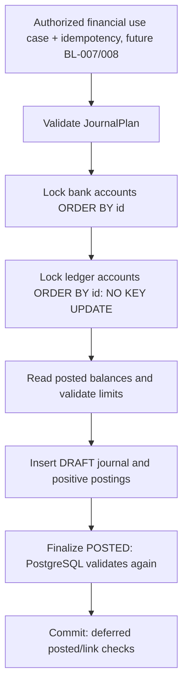

# BL-006 — Ledger foundation

## Actors và business rules

CUSTOMER có account ACTIVE được provision Ledger và xem balance của mình. OPERATOR chỉ xem balance
qua operations route. Các use cases nạp/chuyển/đảo tiền chưa có REST trong BL-006.

| Rule | Điều kiện | Bảo vệ/test |
| --- | --- | --- |
| LED-01 | Customer deposit LIABILITY/CREDIT, clearing ASSET/DEBIT, VND | Chart metadata, type/side CHECK, balance tests |
| LED-02 | 2–100 lines, >=2 distinct ledger accounts, debits=credits | JournalPlan + finalization trigger |
| LED-03 | Amount nguyên dương, <=99999999999999999999, không NaN/Infinity | BigDecimal + unconstrained NUMERIC/CHECK, raw insert tests |
| LED-04 | Journal/ledger/postings cùng currency | Composite FK + VND CHECK |
| LED-05 | Không commit DRAFT, POSTED/lines không sửa/xóa/append/truncate | Deferred/BEFORE triggers; raw SQL tests |
| LED-06 | Customer balance từ POSTED theo normal side, trong [0,max] | Java và DB finalizer, concurrent debit tests |
| LED-07 | Provision/link/marker cùng transaction; marker không reset | Account lock, unique FK, deferred consistency constraint |
| LED-08 | Writes đòi ACTIVE/provisioned, closed/frozen bị chặn | Account contract + DB trigger |
| LED-09 | Close provisioned cần authoritative balance 0; mismatch fail closed | Configured closure guard + bank-account DB trigger |
| LED-10 | Own APIs không tiết lộ account khác; monetary JSON là string | Verified JWT ownership + DTO + huge balance test |

Số dư customer tăng khi CREDIT và giảm khi DEBIT. Asset cash clearing tăng khi DEBIT. Đây là quy ước
kế toán theo loại tài khoản, không quy ước mọi debit luôn làm giảm mọi account.

## REST

JWT và ApiProblem như [IAM](iam.md)/[conventions](conventions.md), no-store và correlation ID.
Các `{accountId}` là UUID account của BL-005, không phải số account 12 chữ số hoặc ledgerAccountId.

| Method/path | Role | Response |
| --- | --- | --- |
| POST `/api/v1/ledger/accounts/{accountId}/provision` | CUSTOMER owner | 200 existing/new link; không request body |
| GET `/api/v1/ledger/accounts/{accountId}/balance` | CUSTOMER owner | 200 posted balance |
| GET `/api/v1/operations/ledger/accounts/{accountId}/balance` | OPERATOR | 200 posted balance |

Provision response ví dụ:

```json
{
  "accountId":"cce779a8-e442-43a9-b2e4-600dd01ba35b",
  "ledgerAccountId":"b4e36a72-4e70-4821-9d4e-a5d4e3e71c69",
  "currency":"VND",
  "accountType":"LIABILITY",
  "normalSide":"CREDIT"
}
```

Provision lặp/concurrent cùng ACTIVE account trả cùng link, không tăng account lifecycle version và
không tạo journal, không phát sinh tiền. FROZEN/CLOSED không được provision, kể cả đã có link trước đó.
Balance vẫn đọc được khi frozen/closed nếu caller có quyền. Nếu chưa provision thì không giả định balance 0.

Balance response:

```json
{"accountId":"cce779a8-e442-43a9-b2e4-600dd01ba35b","currency":"VND","postedBalance":"0"}
```

`postedBalance` **là string chứa số nguyên VND**, không float/double. Client dùng integer/decimal library,
không ép Number khi có thể vượt 2^53−1. Không có `availableBalance`, hold hoặc pending amount giả.
Balance là trạng thái committed đọc hiện tại, chưa có historical/as-of query hoặc statement.

| HTTP/code | Trigger |
| --- | --- |
| 401 UNAUTHENTICATED | Missing/invalid access token |
| 403 ACCESS_DENIED | Sai role; OPERATOR không provision thay owner |
| 404 ACCOUNT_NOT_FOUND | Không tồn tại hoặc ngoài ownership scope |
| 409 ACCOUNT_STATE_INVALID | Provision khi FROZEN/CLOSED |
| 422 LEDGER_NOT_PROVISIONED | Chưa có linkage để đọc balance |
| 422 LEDGER_LINK_INCONSISTENT | Marker/link không nhất quán; cần điều tra, không reset marker để bỏ qua |

Account close từ BL-005 thay đổi: account đã provision và balance 0 có thể đóng; nonzero trả
422 ACCOUNT_BALANCE_NOT_ZERO. ACCOUNT_CLOSURE_UNAVAILABLE vẫn dành cho dữ liệu không đủ nhất quán.
Provisioning không tạo lifecycle history mới vì không đổi state/version; transaction rollback giữ cả marker/link.

## Internal posting contract — không phải public API

`LedgerPostingService.post(LedgerPostingCommand)` đòi outer transaction (MANDATORY), actor context và
READ COMMITTED. Financial caller BL-007/008 phải kiểm tra quyền người ra lệnh, ownership tài khoản nguồn,
idempotency, request hash và limits trước khi gọi. Không cho client tự cung cấp clearing/ledger IDs/actor/kind.
Một journal cho một financial command; nếu nhiều journal trong một transaction cần coordinator pre-lock.

Command gồm reference UUID, kind và lines (ledgerAccountId, DEBIT/CREDIT, BigDecimal amount). Mỗi reference
unique; lặp trả 409 LEDGER_REFERENCE_EXISTS, không replay result hay chứng minh payload trùng. Sửa reference
để retry sẽ tạo command mới nếu caller không có idempotency; vì vậy chưa mở REST ghi tiền ở BL-006.

| Code | Điều kiện |
| --- | --- |
| LEDGER_REQUEST_INVALID | Thiếu command/reference/kind |
| LEDGER_POSTINGS_INVALID | Thiếu/null/quá nhiều lines, thiếu ID/side hoặc <2 distinct accounts |
| LEDGER_AMOUNT_INVALID | Null, âm/0, phần lẻ hoặc quá lớn |
| LEDGER_JOURNAL_UNBALANCED | Tổng debit khác credit |
| LEDGER_ACCOUNT_NOT_FOUND | Ledger ID không tồn tại |
| LEDGER_INSUFFICIENT_FUNDS | Customer balance sau journal âm |
| LEDGER_BALANCE_LIMIT | Cộng dồn customer balance vượt max20digits |
| LEDGER_REFERENCE_EXISTS | Reference đã dùng |

Database SQL guard failures có SQLSTATE 23514; service validates expected business errors trước khi ghi.
Unexpected database failure rollback toàn transaction; không trả SQL/amount/actor details ra client.

## Data và transaction flow

V4 thêm `ledger_accounts`, `ledger_journals`, `ledger_postings`, ledger_balance function và triggers.
Chart seed chỉ một clearing account metadata, không amount/customer/linkage. Postings có indexes theo
journal và ledger account; balance SUM không qua cached projection. Không sửa V1–V3.



Bank locks phối hợp posting/provisioning/close/freeze; ledger locks phối hợp financial writers và FK.
Java và SQL cùng thứ tự bank→ledger, sort tại PostgreSQL. Isolation khác READ COMMITTED bị DB finalizer từ chối.
Khi rollback không có journal/line/balance partial. Không suy diễn timeout là chưa commit: use case tiền phải
có durable transaction identity/status query/idempotency ở BL-007/008.

## Acceptance evidence

LedgerIT có HTTP JWT/JWKS thật cho ownership/roles/provision/balance; internal posting tests dùng actor fixture
để kiểm tra primitive giao dịch, **không phải bằng chứng JWT verification**. Direct SQL tests bỏ qua Java để
kiểm tra constraints/locks. JournalPlanTest kiểm tra arithmetic/amount/shape thuần Java. PackagedApplicationIT
kiểm tra đủ source classes và migration V4 trong JAR. Chi tiết kết quả ở [phiếu review](../reviews/BL-006.md).

Giới hạn: chưa public cash-in/transfer/reversal, holds/pending payment, projection/reconciliation jobs,
production DB role separation, audit chống DBA sửa, multi-currency hoặc báo cáo hiệu năng. Xem
[ADR-004](../architecture/ADR-004-ledger-posting.md) về lý do, tradeoffs và gates trước feature tiền.
